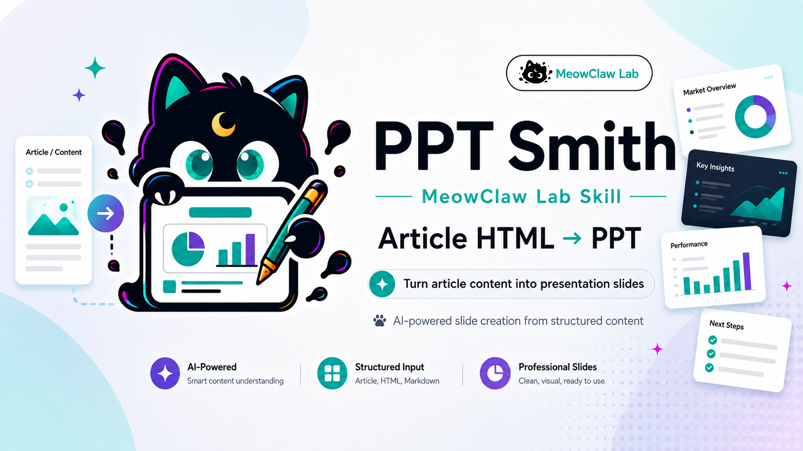
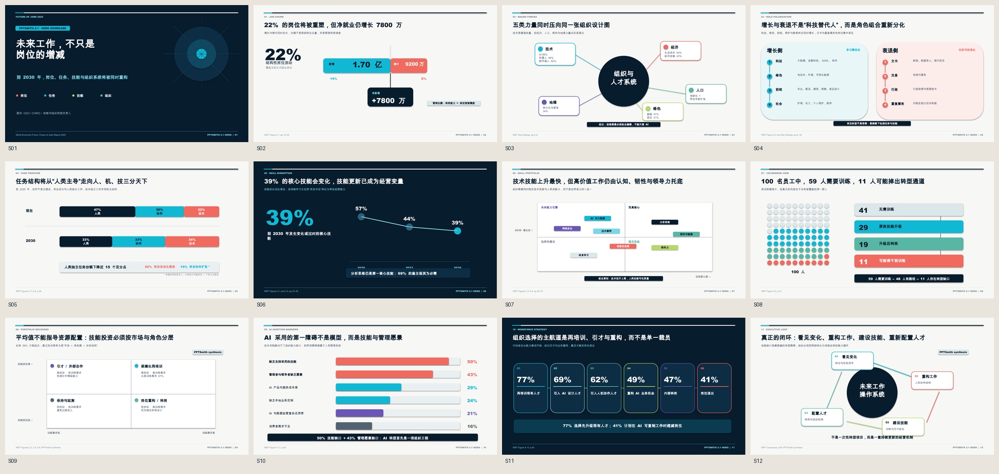
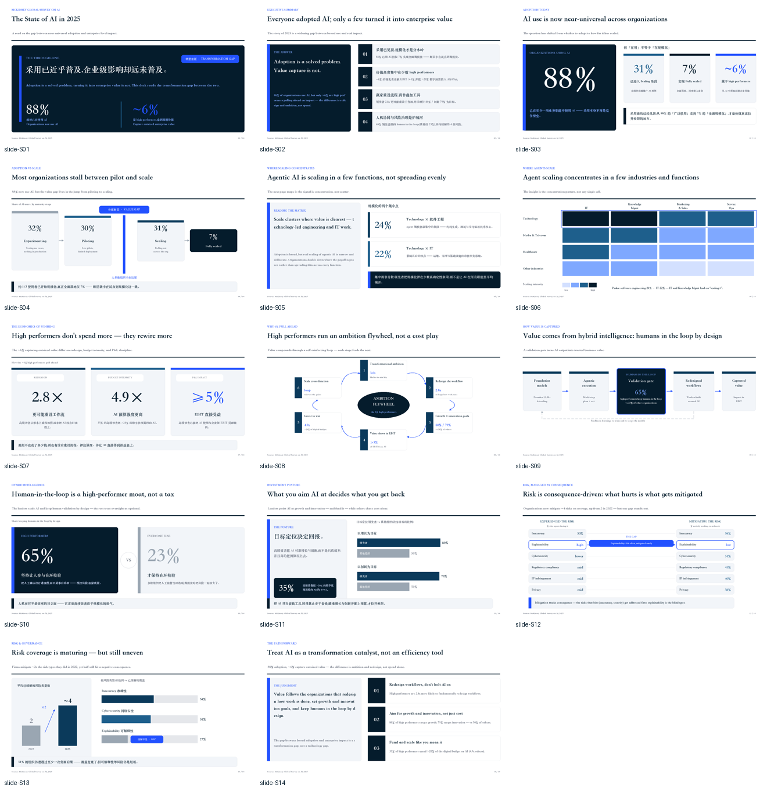
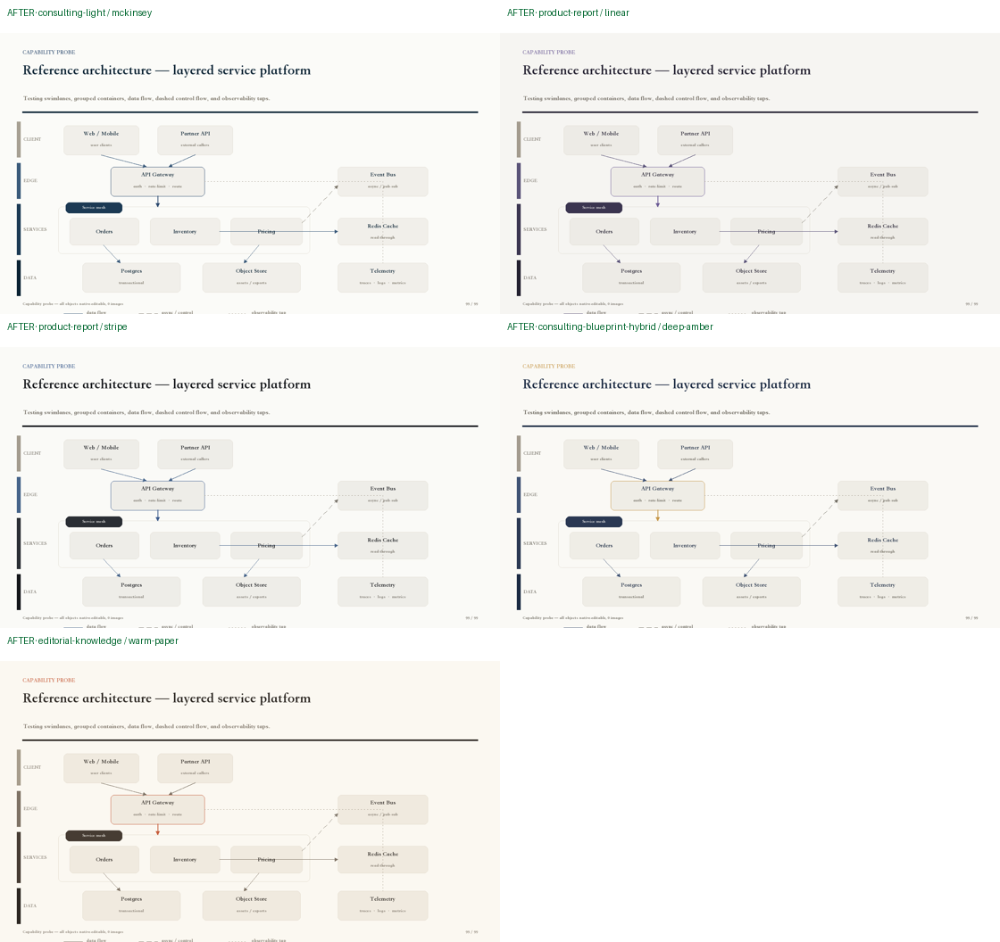
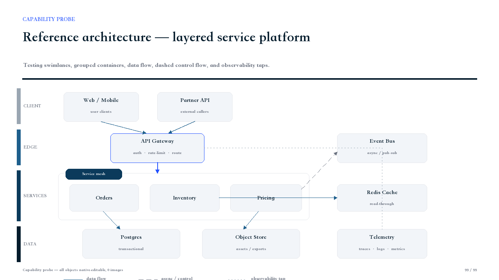

# MeowClaw Lab

> 中文版本: [README.md](./README.md)

MeowClaw Lab is a reliability-first home for reusable OpenClaw skills, workflows, and operational playbooks.

The repository goes beyond prompts that merely run. Its production workflows define capability probes, consent boundaries, failure behavior, and evidence-based completion. It currently maintains two projects: the professional presentation skill `article-html-to-ppt` and the safe-upgrade skill `openclaw-verified-upgrade`.

## MeowClaw PPT Smith v3.0.1

<p align="center">
  
</p>

[`MeowClaw PPT Smith`](./Skills/article-html-to-ppt/) turns articles, Markdown, HTML, WeChat drafts, PRDs, research, and design specifications into **low-rework, editable, and verifiable** professional presentations.

**Core capabilities:**

- content analysis, evidence inventory, storyline, judgment titles, and expression planning before layout;
- five foundational visual systems for consulting, product, technical, hybrid, and editorial decks;
- Style Contract v2 to pin colors, typography, grid, spacing, cards, tables, charts, and diagram rules;
- dual real Builders (`python_pptx` and PptxGenJS) with capability-aware routing;
- PPT IR, Diagram IR, Component Registry, and Delivery Plan routing for editable and hybrid components;
- task routing, Page Design Intent, Visual Planner, and Deck Rhythm gates for stronger visual narratives;
- the v2.0.7 native straight, orthogonal/elbow, and curved connector contract remains supported; process arrows must be single connector objects with endpoints bound by a qualified Builder;
- topology gates that reject lines through unrelated nodes or text, ambiguous crossings, unbound relationships, and undeclared blank solid-color blocks;
- Fast / Standard / Premium production profiles;
- capability probes, structural inspection, real rendering, enlarged single-slide review, readback, visual scoring, and trusted Delivery Manifests;
- local PPTX, native progressive-build PPTX, HTML preview, and consent-gated Feishu Slides routes.

[Read the Chinese-first PPTSmith guide →](./Skills/article-html-to-ppt/README.md)

> v3.0.1 retains v3.0.0’s high-fidelity Code Path, IR/Pipeline path, eight professional routes, and real-render QA. The PMO production runtime is public on GitHub and is included in registry packages; local tests, generated decks, rendered files, QA logs, and caches are excluded from registry uploads. Standard has passed real rendering and structural readback on the verified macOS + LibreOffice environment. Path A still requires model-appropriate human visual review; native Microsoft PowerPoint compatibility still requires target-environment validation.

## v3.0.1: Public PMO Runtime, Bespoke Code, and Verified Pipeline

- **Path A — Code Path** lets an LLM write `python-pptx` directly for editable flywheels, complex native arrows, asymmetric composition, and high-value page-level craft—the capability boundary of the best v1.2.0 outputs.
- **Path B — IR / Pipeline Path** supplies structured IR, visual narrative planning, component routing, and real-render QA for repeatable, auditable standard production. Its IR completeness and evidence-quality gate requires source-bound primary data and independent evidence; insufficient input stops delivery with named blockers instead of mislabeling a rendered deck as `verified`.

See the [v3.0.1 public-PMO release notes](./Skills/article-html-to-ppt/docs/v3.0.1-release-notes.md) and [v3.0.0 release notes](./Skills/article-html-to-ppt/docs/v3.0.0-release-notes.md) for distribution boundaries, trade-offs, the v1.2.0 comparison, and fixed-material multi-model/path image evidence.

## v3.0 Hero Showcase

The 12-slide *Future of Work 2030* showcase is built from native text, shapes, connectors, charts, and tables. It passed real rendering without whole-slide rasterization. It demonstrates the visual upper bound of v2.1, not a promise that every source reaches the same result in one automatic pass.



## Real PPT Output Gallery (Preserved Sample)

These images come from the earlier 14-slide stress test based on McKinsey / QuantumBlack’s public *The State of AI in 2025* report. They show actual generated output rather than conceptual placeholders:

- **No raster screenshots as body slides**: core text, cards, tables, nodes, arrows, and relationship diagrams are native PPT objects.
- **302 editable text runs** for continued editing in PowerPoint, Keynote, or Feishu Slides.
- **Richer relationship graphics** including curved arrows, dashed lines, polylines, elbow connectors, and double arrows.
- **Upgraded palette contracts** across five low-chroma, warm-tempered foundational styles.







## OpenClaw Verified Upgrade

[`openclaw-verified-upgrade`](./Skills/openclaw-verified-upgrade/) treats an OpenClaw upgrade as a recoverable, auditable transaction rather than a one-shot update command. Completion requires verified agreement across the selected package, running Gateway, configuration, critical routes, and a bounded stability window.

It exposes two explicit runtime profiles:

- **V2 managed:** enabled only when `openclaw_upgrade_harness` is available and its coordinator is ready and compatible with the running OpenClaw version. The coordinator owns package mutation, Gateway lifecycle, crash recovery, the transaction ledger, and stability observations.
- **Lite supervised:** uses the bundled transaction guard and an operator-visible CLI workflow when the V2 plugin or coordinator is absent, incompatible, or unhealthy. It never claims autonomous continuity across a Gateway restart.

Both profiles enforce the same boundaries: a vague request authorizes planning only, backup evidence is required before mutation, a transaction can begin the core update only once, recovery and rollback need separate approval, an already-installed target is never blindly reinstalled, and completion requires fresh evidence.

[Read the OpenClaw Verified Upgrade guide →](./Skills/openclaw-verified-upgrade/README.md)

## Skills

| Skill | Purpose | Status |
| --- | --- | --- |
| [`article-html-to-ppt`](./Skills/article-html-to-ppt/) | MeowClaw PPT Smith with public PMO runtime, Path A code generation, Path B verified pipeline, eight professional routes, native connector routing, and trusted QA. | v3.0.1 |
| [`openclaw-verified-upgrade`](./Skills/openclaw-verified-upgrade/) | A safe OpenClaw upgrade transaction with Lite supervised and V2 managed runtime profiles. | Published |

## Design Principles

- **User-facing flow should be simple.** Users should state the goal, not wrestle with low-level commands, platform permissions, or export mechanics.
- **Internal flow should be operationally strict.** Capability checks, risk review, backups when needed, controlled execution, and result verification should happen before completion is claimed.
- **Latest is not automatically best.** For upgrade workflows, prefer a stable target unless the user explicitly asks for latest or latest fixes a relevant issue.
- **Created does not mean final.** For docs, slides, videos, apps, and other deliverables, distinguish `Created`, `Rendered`, `Read back`, and `Final`.
- **Source boundaries matter.** External articles, images, screenshots, reconstructed visuals, and quoted material must keep their usage boundaries; reference material should not be presented as owned evidence.
- **Consent matters.** Installing, updating, overwriting, force-upgrading, restarting, rolling back, uploading, or publishing requires explicit authorization.

## Repository Layout

```text
MeowClawLab/
├── README.md
├── README.en.md
├── README.zh-CN.md
├── LICENSE
└── Skills/
    ├── article-html-to-ppt/
    │   ├── README.md
    │   ├── README.en.md
    │   ├── SKILL.md
    │   ├── skill-card.md
    │   ├── references/
    │   └── templates/
    └── openclaw-verified-upgrade/
        ├── README.md
        ├── README.zh-CN.md
        ├── SKILL.md
        └── test-prompts.json
```

## Using A Skill

Copy or install the desired skill directory into your OpenClaw skills path, then ask your agent to use it for the matching task.

For example, `openclaw-verified-upgrade` is intended for prompts like:

```text
Help me safely upgrade OpenClaw.
Upgrade OpenClaw to a stable version and make sure Gateway still works.
Upgrade OpenClaw to version 2026.x.x with backup and rollback planning.
```

`article-html-to-ppt` is intended for prompts like:

```text
Turn this WeChat article into Feishu Slides.
Convert this Markdown draft into a formal brand-consistent PPT.
Create the presentation storyboard and HTML preview before exporting to slides.
Build an editable AI engineering project deck and verify connector topology and final rendering.
```

## Safety Note

These skills may interact with a running OpenClaw Gateway, external platforms, document uploads, slide generation, or public publishing. Upgrades, restarts, rollbacks, config repairs, daemon edits, skill updates, Feishu uploads, and GitHub publishing are state-changing actions that require clear authorization and verification.
