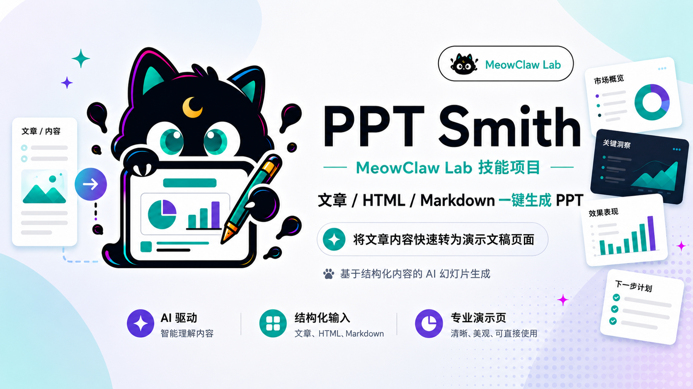
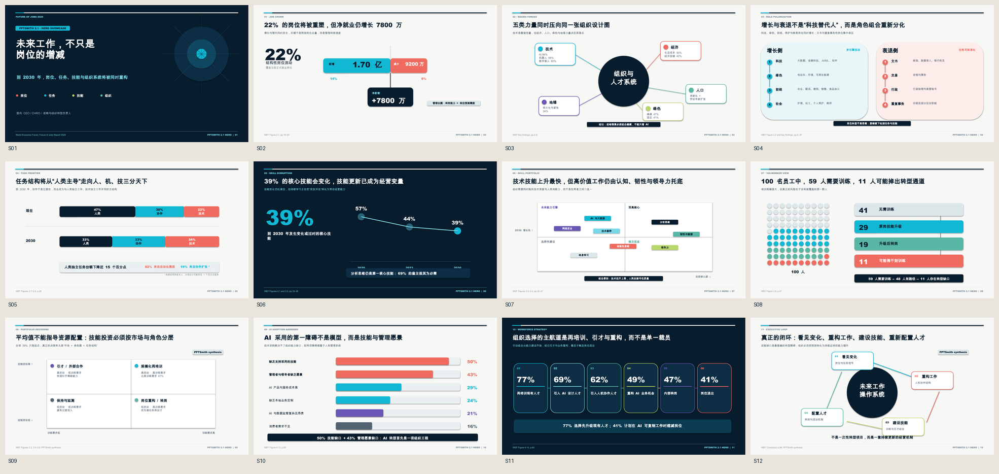
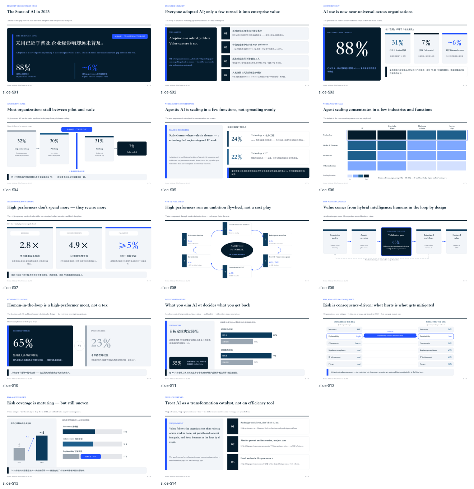
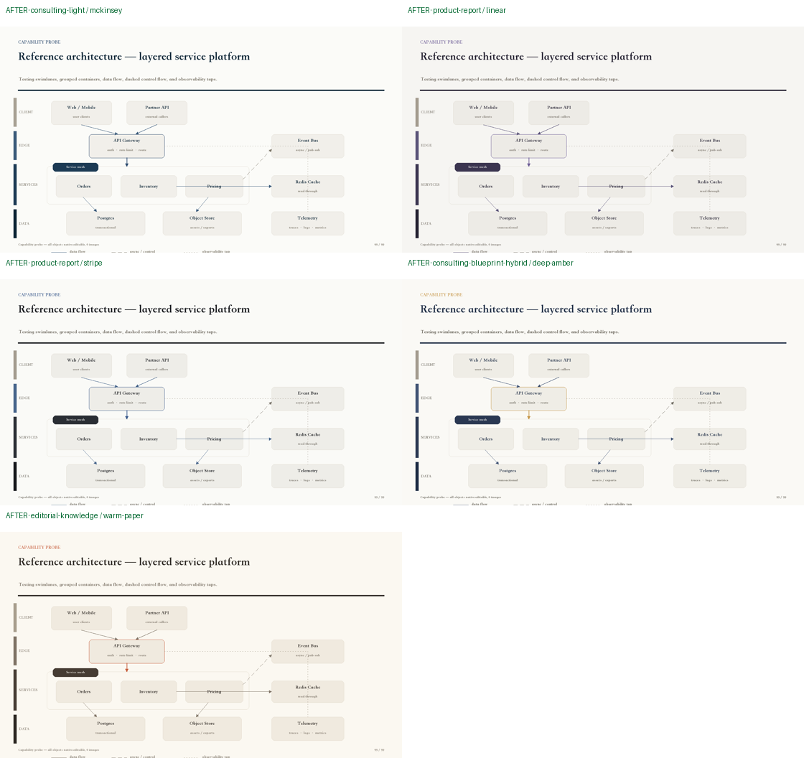
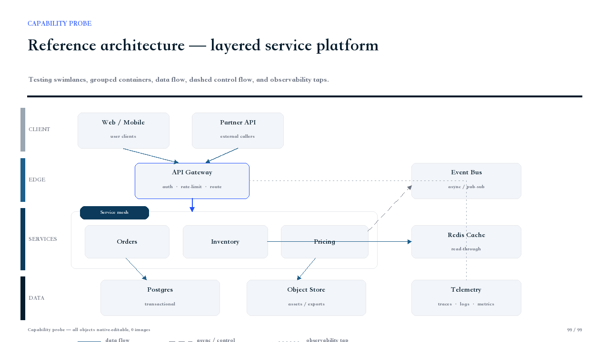

# MeowClaw Lab

> English version: [README.en.md](./README.en.md)

MeowClaw Lab 是一个面向 OpenClaw 的可靠自动化实验室，沉淀可复用的 Skills、工作流和运维 playbook。

这里不只提供“能跑”的提示词，而是提供带能力探测、授权边界、失败处理和交付验证的生产级工作流。当前维护两个项目：专业 PPT 生产 Skill `PPT Smith`，以及 OpenClaw 安全升级 Skill `openclaw-verified-upgrade`。

## MeowClaw PPT Smith v2.1.2

<p align="center">
  
</p>

[`MeowClaw PPT Smith`](./Skills/article-html-to-ppt/) 把文章、Markdown、HTML、公众号草稿、PRD、研究材料和设计说明转成**低返工、可编辑、可验证**的专业演示文稿。

**核心能力：**

- **内容先于排版：** 内容分析、证据盘点、故事线、判断式标题与表达模式先行。
- **五套基础视觉系统：** 咨询报告、产品汇报、技术蓝图、咨询 × 技术混合、编辑知识型。
- **Style Contract v2：** 锁定颜色、字体、网格、间距、卡片、表格、图表和图解规则，减少模型间视觉漂移。
- **双 Builder + 自动选路：** 支持 `python_pptx` 与 PptxGenJS，并按环境能力选择构建路径。
- **复杂图解与组件路由：** 通过 PPT IR、Diagram IR、组件注册表与 Delivery Plan，兼顾复杂表达和核心信息可编辑性。
- **Visual Planner 与节奏门禁：** 根据任务类型、页面角色与证据结构选择矩阵、架构、下钻、路线图等表达，并阻断原型单一、卡片过载和关键视觉页不足。
- **原生连接器与拓扑门禁：** 保留 v2.0.7 的直线、肘形/正交和曲线连接器路由；流程箭头必须是单一连接器对象，并在合格 Builder 中绑定两端节点。
- **图解质量阻断：** 自动拒绝穿过无关节点或文字的直线、歧义交叉、未绑定关系，以及未声明的空白实色色块。
- **Fast / Standard / Premium：** 根据草稿、正式汇报或高价值交付自动匹配工件与验证强度。
- **可信 QA：** 能力探测、结构检查、真实渲染、放大单页复核、回读、视觉评分与交付清单逐层验证，明确区分 `Created`、`Rendered`、`Read back`、`Verified` 与 `Final`。
- **多出口交付：** 支持本地 PPTX、原生渐进式动态 PPTX、HTML 预览，以及经明确授权后的飞书幻灯片路线。

[查看 PPTSmith 中文说明与快速用法 →](./Skills/article-html-to-ppt/README.md)

> v2.1.2 Standard 已在 macOS + LibreOffice 验收环境通过真渲染、结构回读与回归测试，并修复 macOS 渲染路径注入、测试夹具清理越界和字体清单过度披露风险。2.1.2 还移除了安全测试中的动态模块执行。原生 Microsoft PowerPoint 兼容性仍需在目标环境单独验收。

## v2.1 Hero Showcase

《未来工作 2030》展示稿由原生文本、形状、连接线、图表和表格构建，12/12 页真渲染通过，未整页图片化。它用于展示 v2.1 的视觉叙事上限，不代表每份材料都能一次自动达到同等完成度。



## 真实 PPT 效果展示（保留样例）

以下图片来自此前使用 McKinsey / QuantumBlack 公开报告 *The State of AI in 2025* 进行的 14 页压力测试，用于展示真实生成效果，不是概念占位图：

- **0 张栅格贴图作为正文页**：核心文本、卡片、表格、节点、箭头和关系图均为 PPT 原生对象。
- **302 段可编辑文本**：便于后续在 PowerPoint、Keynote 或 Feishu Slides 中继续修改。
- **复杂关系图增强**：包含曲线箭头、虚线、折线、肘线和双箭头等图元。
- **配色契约升级**：五套基础风格采用低饱和、有色温、克制的配色体系。







## OpenClaw Verified Upgrade

[`openclaw-verified-upgrade`](./Skills/openclaw-verified-upgrade/) 把 OpenClaw 升级视为一笔可恢复、可审计的事务，而不是简单执行一次更新命令。完成标准是目标 package、运行中的 Gateway、配置、关键路由与稳定性观察窗口全部通过验证。

它提供两种明确的运行档：

- **V2 managed：** 仅在 `openclaw_upgrade_harness` 可用、协调器就绪且与当前 OpenClaw 版本兼容时启用；由协调器负责 package 变更、Gateway 生命周期、崩溃恢复、事务账本和稳定性采样。
- **Lite supervised：** 当 V2 插件或协调器缺失、不兼容或不健康时，使用 Skill 自带事务守卫和操作者可见的 CLI 流程；不会虚假宣称 Gateway 重启后仍可自主续接。

共同安全边界包括：模糊升级请求只生成计划、变更前必须验证备份、单次事务最多执行一次核心升级、恢复和回滚需要独立授权、目标版本已安装后禁止盲目重跑，以及没有新鲜证据就不能宣称完成。

[查看 OpenClaw Verified Upgrade 中文说明 →](./Skills/openclaw-verified-upgrade/README.zh-CN.md)

## 技能列表

| 技能 | 用途 | 状态 |
| --- | --- | --- |
| [`article-html-to-ppt`](./Skills/article-html-to-ppt/) | MeowClaw PPT Smith：Visual Planner、双 Builder、三档生产、原生连接器路由、视觉门禁与可信 QA。 | v2.1.2 |
| [`openclaw-verified-upgrade`](./Skills/openclaw-verified-upgrade/) | 带 Lite supervised 与 V2 managed 双运行档的 OpenClaw 安全升级事务。 | 已发布 |

## 设计原则

- **用户入口要简单。** 普通用户只需要表达目标，不应该被迫理解底层命令、平台权限和交付格式细节。
- **内部流程要严格。** 执行前必须做能力检查、风险评估、必要备份、受控执行和结果验证。
- **最新不等于最好。** 对升级类任务，除非用户明确要求 latest，或 latest 修复了当前相关问题，否则优先推荐相对稳定版本。
- **创建成功不等于最终完成。** 对文档、幻灯片、视频、应用等交付物，要区分 `Created`、`Rendered`、`Read back` 和 `Final`。
- **来源边界要清楚。** 外部文章、图片、截图、复原图和引用内容必须保留使用边界，不能把参考材料包装成自有事实。
- **授权边界要清楚。** 安装、更新、覆盖、强制升级、重启、回滚、上传、发布等状态变更都需要明确授权。

## 仓库结构

```text
MeowClawLab/
├── README.md
├── README.en.md
├── README.zh-CN.md
├── LICENSE
└── Skills/
    ├── article-html-to-ppt/
    │   ├── README.md
    │   ├── README.en.md
    │   ├── SKILL.md
    │   ├── skill-card.md
    │   ├── references/
    │   └── templates/
    └── openclaw-verified-upgrade/
        ├── README.md
        ├── README.zh-CN.md
        ├── SKILL.md
        └── test-prompts.json
```

## 如何使用技能

把需要的技能目录复制或安装到 OpenClaw 的 skills 路径中，然后让 agent 在匹配任务时使用该技能。

例如，`openclaw-verified-upgrade` 适合这些请求：

```text
帮我安全升级 OpenClaw。
把 OpenClaw 升级到稳定版本，并确认 Gateway 还能正常工作。
把 OpenClaw 升级到 2026.x.x，升级前备份，失败时要有回滚计划。
```

`article-html-to-ppt` 适合这些请求：

```text
把这篇公众号文章转成飞书幻灯片。
把这份 Markdown 草稿做成正式品牌版 PPT。
先生成演示分镜和 HTML 预览，再导出到幻灯片。
为这份 AI 工程项目汇报生成可编辑 PPT，并验证连接器拓扑和最终渲染。
```

## 安全提示

这些技能可能涉及运行中的 OpenClaw Gateway、外部平台、文档上传、幻灯片生成或公开发布。升级、重启、回滚、配置修复、daemon 修改、skill 更新、飞书上传、GitHub 发布等都属于状态变更操作，应在明确授权和验证后执行。
